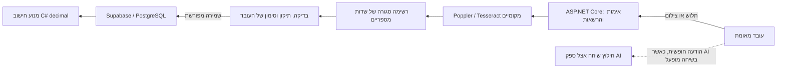

# CarWise — סקירת אבטחה ופרטיות

תאריך: 20 באוקטובר 2026. גרסת הקוד שנבדקה: `f3d1da62cd24be363a1263b68691df48daa44e49`.

## מסקנה והיקף

יש בסיס אבטחה שניתן להציג עם ראיות: שער C# לפעולות רגישות, הפרדת משתמשים, מנוע חישוב דטרמיניסטי, מפתחות מוצפנים וחילוץ תלושים מקומי. קיימים פערים משמעותיים לפני שימוש בנתוני עובדים אמיתיים. ההמלצה היא להציג בהאקתון נתונים סינתטיים ולהציג לצד הבקרות גם תוכנית סגירה לפערים. אין בסיס להצהרת ״מאובטח לחלוטין״ או ״מאושר לייצור״.

זו סקירת קוד ותצורה במאגר, בדיקות אוטומטיות בסביבה מבודדת ובדיקת מקורות ציבוריים. אין כאן מבדק חדירה מלא, בדיקה בחשבון Supabase/Google Cloud האמיתי, אישור משפטי, אימות הצפנת גיבויי ייצור או בחינת כל מערכות הניטור והאירוח. הבדיקות השתמשו בנתונים פיקטיביים. הקוד התפעולי לא שונה במסגרת הסקירה.

תוצאות המכונה והיקף הבדיקות נמצאים ב־[קובץ הראיות](security/evidence-2026-10-20.json). [תוכנית העבודה](security-roadmap.md) מגדירה תוצרים וקריטריוני קבלה.

## זרימת המידע בפועל

התלוש והטקסט הגולמי אינם נשלחים ל־AI במסלול התלושים. כלי ה־OCR רצים כעת כתהליכים מקומיים בתוך סביבת השרת, לא בתוך worker מבודד. צילום אינו מוקלט או מועלה אוטומטית; נדרשת פעולה מפורשת של העובד. החילוץ אינו שומר שדות: לאחר סקירה והעברה לטופס נדרשת ״שמירה וחישוב מחדש״.

**הצ׳אט הוא מסלול נפרד:** כאשר AI מופעל, ההודעה החופשית שהעובד כתב מועברת לספק. לכן עיבוד מקומי של התלוש אינו מוכיח שכל המידע במערכת נשאר בתוך הארגון. נתוני פרופיל מלאים אינם מצורפים אוטומטית לבקשת חילוץ השיחה. בקשת ניסוח התשובה משתמשת במצייני מקום, והסכומים מוצבים על ידי הקוד.

## בקרות קיימות והראיות להן

| בקרה | מצב וגבולות | ראיה |
|---|---|---|
| זהות ותפקיד | אימות אסימון מול Supabase Auth; תפקיד מתוך `app_metadata`, לא מתוך תפקיד שהדפדפן שולח | [AccessControl](../backend/CarWise.Api/Infrastructure/AccessControl.cs), בדיקת `AuthDoesNotTrustUserEditableRole` |
| הפרדת עובדים | מזהה עובד נבדק בשרת לפני שיחה, היסטוריה, עדכון פרופיל וחילוץ תלוש; למנהל גישה רחבה במפורש | `AccessControl.Employee`, [נקודת החילוץ](../backend/CarWise.Api/AI/PayslipExtraction.cs), בדיקות אינטגרציה של 401/403 |
| הרשאות DB לדפדפן | RLS מופעל וגישת `anon`/`authenticated` לטבלאות נשללת. השרת משתמש ב־service role העוקף RLS; בידוד העובדים נשען על ה־API | [מיגרציה](../supabase/migrations/202610190001_carwise.sql), בדיקת PostgREST של דחיית גישה אנונימית |
| צמצום מידע בתלושים | מוחזרים שבעה שדות מוגדרים בלבד. אסמכתאות הן תווית קבועה ומספר, לא ציטוט מהתלוש; זיהוי חלש או עמום אינו הופך לאפס | [LocalPayrollFields](../backend/CarWise.Api/AI/LocalPayrollFields.cs), `LocalPayrollTests` |
| טיפול בקבצים | סוג וגודל מוגבלים, בדיקות ממדי תמונה, מספר עמודים, זמן ופלט; עד שני חילוצים מקבילים בתהליך | [LocalImageLimits](../backend/CarWise.Api/AI/LocalImageLimits.cs), [LocalPayslipOcr](../backend/CarWise.Api/AI/LocalPayslipOcr.cs). אין בכך בידוד או סריקת נוזקות |
| אי־שמירת קובץ מקור | קלט ופלט עוברים בצינורות זיכרון; היישום אינו יוצר קובץ תלוש מתמשך. מאגרי בתים עיקריים מאופסים | `UploadReader`, `LocalPayslipOcr`, `PayslipExtraction`. אין הבטחה למחיקת כל עותק בזיכרון, swap או תיעוד של תשתית חיצונית |
| מפתחות | סודות ספק מוצפנים ב־DB, אינם מוחזרים ללקוח וקשורים לדומיין; חיבור Supabase נשמר מוצפן בשרת | [SecretVault](../backend/CarWise.Api/Administration/SecretVault.cs), `ServerConnectionStore`, בדיקות הצפנה ואי־העברת מפתח לספק אחר |
| חישוב וזכאות | חישוב ב־C# decimal; קבוצת הזכאות נגזרת מעיסוק בשרת; שינוי עיסוק חסום לעובד. אישורי השתתפות אינם מתקבלים מ־`overrides` בדפדפן | [PayrollEngine](../backend/CarWise.Api/Domain/PayrollEngine.cs), [AdvisorService](../backend/CarWise.Api/Domain/AdvisorService.cs), בדיקות תרחישים וזיוף ערכים |
| AI ופלט לא תקין | פלט מובנה, בדיקות טווח ומספרים שנמסרו, תבניות לניסוח, ללא סמכות למודל להעניק תפקידים | `Extraction`, `Narration`, בדיקות סירוב למספרי נטו מומצאים. אלו בקרות לתרחישים מוגדרים, לא הוכחה לחסינות כללית מפני Prompt Injection |
| HTTP ודפדפן | `no-store` ל־API, מניעת framing, `nosniff`, בדיקת Origin לכתיבה ודרישת HTTPS ל־API בייצור | [Program](../backend/CarWise.Api/Program.cs), [RequestProtection](../backend/CarWise.Api/Infrastructure/RequestProtection.cs). CSP מוגבל ל־framing ואינו מדיניות סקריפטים מלאה |

## ממצאים המחייבים טיפול

P0 משמעו תנאי מעבר לשימוש אמיתי לפי תוכנית זו; הוא אינו קביעה שנמצא ניצול קריטי בפועל. P1 הוא חיזוק נדרש לקראת מוצר. הממצאים להלן מבוססים על קוד, אלא אם מצוין שהמצב בתשתית לא אומת.

### SEC-01 — בידוד ותחזוקת מנוע המסמכים — P0

`LocalPayslipOcr` מפעיל קובצי הרצה ללא shell ומנקה משתני סביבה רגישים. עם זאת, התהליכים יורשים את זהות מערכת ההפעלה והגישה לקבצים/רשת שלה. ניקוי משתני סביבה אינו מונע קריאת keyring או קובצי שרת במקרה של פגיעה בכלי native. אין בקוד sandbox ברמת OS, מגבלת זיכרון/CPU קשיחה או סריקת נוזקות.

נדרש worker מבודד שאינו מקבל מפתחות, ללא יציאה לרשת, עם הרשאות ומערכת קבצים מצומצמות, מגבלות משאבים ועדכוני אבטחה. סורק קבצים מאושר הוא שכבת הגנה נוספת, לא תחליף לבידוד. גרסאות הכלים בסביבת הבדיקה אינן אחידות: Tesseract 5.5.0, `pdftotext` 25.03.0 ו־`pdftoppm` 26.05.0. לא בוצעה סריקת CVE של החבילות native או הספריות המקושרות שלהן.

### SEC-02 — אימות חזק ויציאה מחשבון — P0

אין במימוש אכיפה של MFA/AAL2 למנהל ולנציג. בחירת לשונית ״כניסת מנהל״ אינה אימות נוסף; התפקיד כן נקבע בשרת. יציאה בממשק מסירה את האסימון מ־`sessionStorage`, ללא קריאת logout/revocation לשרת האימות. אסימון שנגנב עשוי להמשיך להיות שמיש לפי תוקפו ומדיניות Supabase.

נדרשים MFA או SSO ארגוני מתאים, בדיקת רמת האימות בצד השרת לפעולות רגישות, מדיניות תוקף/חידוש והגדרת ביטול הפעלות. יש לתכנן במפורש שמירת הפעלה בדפדפן והגנת XSS/CSRF; מעבר ל־cookies לבדו אינו פתרון מלא.

### SEC-03 — הרשאות נציגים ומזעור נתוני פנייה — P0

ב־`Program.cs`, קריאת `/api/tickets` אינה מסננת לפי שיוך לנציג כאשר `IsAgent=true`. כל נציג רשאי לענות לכל מזהה פנייה דרך `AccessControl.Agent`. כל פנייה מכילה `Employee` snapshot, כולל פרטי שכר. אין כרגע מודל של פנייה שהוקצתה לנציג, תחום ארגוני או הרשאות ברמת שדות.

זו ההתנהגות הממומשת, ולכן אין להציג לשופטים טענה ש״נציג רואה רק פניות שהוסמך לטפל בהן״. נדרשים שיוך/תחום מפורש, סינון קריאות וכתיבות בשרת ו־DTO מצומצם לנציג. יש להגדיר בנפרד מה מנהל רשאי לראות ובאילו נסיבות.

### SEC-04 — מחזור חיי מידע ומשתמשים — P0

אין מדיניות מחיקה אוטומטית לשדות שכר, הודעות חופשיות ופניות. מידע עשוי להופיע בפרופיל, במצב שיחה, ב־ticket snapshots ובהיסטוריית ההגדרות הכוללת רשימות עובדים. מגבלת עשר גרסאות היסטוריה אינה תקופת שימור.

הסרת עובד מרשימת ההגדרות אינה כשלעצמה השבתת חשבון Supabase או מחיקת ההיסטוריה שלו. נתיבי היסטוריה ושיחה בודקים התאמת `employee_id` לאסימון, ללא בדיקת סטטוס העסקה פעיל. סיכון גישה לאחר הסרה נגזר מניתוח הקוד; הוא לא שוחזר בחשבון אמיתי. השבתה חיצונית של החשבון עשויה לשנות את התוצאה.

נדרש תהליך offboarding אחד שמטפל בזהות, בהפעלות, בהרשאות ובכל העתקי המידע לפי מדיניות. הקובץ המקורי אינו נשמר ולכן אין צורך להוסיף Bucket רק כדי להדגים מחיקת תלוש. מחיקת הנתונים הנגזרים עדיין נדרשת. אם בעתיד נדרשת שמירת מקור, יש לתכנן זאת כמסלול חדש עם אחסון פרטי, TTL, ביקורת ואישור נפרד.

### SEC-05 — מדיניות מידע לספק AI ו־ZDR — P0 כאשר AI חיצוני מופעל

חילוץ שיחה שולח את ההודעה החופשית לספק. אין סינון/שער מדיניות שמוכיח מניעת שליחת ת״ז, בנק או שכר שהעובד הקליד. חשבונאות טוקנים אינה אישור פרטיות. לא אומתו תנאי השמירה, אזורי העיבוד, קבלני המשנה או הסכמי העיבוד של חשבונות הספק בפועל.

המתאם `gemini` הקיים משתמש ב־Gemini Developer API עם מפתח ובכתובת `generativelanguage.googleapis.com`; אין מתאם Vertex/Google Cloud עם OAuth/Workload Identity. שינוי שם המודל או סימון תיבה אינו משנה את החוזה או מבטיח ZDR. תלושים נשארים מקומיים גם אם אין מתאם ארגוני.

### SEC-06 — הגבלת שימוש, עלויות וביקורת — P1; תנאי לפני הפעלת AI בייצור

מדיניות העלאות מנסה להסתמך על `context.Items["caller"]`, אך `UseRateLimiter` נמצא לפני middleware האימות שממלא אותו. לפי סדר ה־pipeline, ההגבלה נשענת בפועל על IP; משתמשים מאחורי NAT חולקים מכסה. היא אינה הגבלת משתמש מוכחת, ואינה מכסה כמה מופעי שרת.

לצ׳אט אין בנתיב הקיים הגבלת קריאות ייעודית או תקרת הוצאה אוכפת למשתמש. מגבלות זמן/טוקנים ויומן עלויות קיימים, אך אינם עוצרים תקציב מצטבר או ריבוי קריאות במקביל. נדרשים quotas לפי זהות/ארגון, תקציב עם עצירה, טיפול בעומס ומדיניות על כמה מופעים.

היסטוריית הגדרות ויומן עלויות אינם Audit Log מלא. אין תיעוד מאוחד ומוגן משינוי של גישות לשכר, שינויים בהרשאות, איפוסי חשבונות ומחיקות. הביקורת צריכה לשמור מזהים ואירועים מצומצמים, ולא תוכן תלושים או הודעות.

### SEC-07 — הפעלה, דפדפן, מפתחות וגיבויים — P0/P1 לפי סביבת היעד

ה־CSP הנוכחי הוא `frame-ancestors 'none'` בלבד. אין בקוד מדיניות `script-src` מלאה או HSTS. בדיקת HTTPS חלה על API בייצור; יש לאמת גם TLS והפניות לכל האתר, פרוקסי מהימנים ומניעת דליפת סודות בתשתית. אסימון ב־sessionStorage נגיש ל־JavaScript; לא הודגם XSS, אך נדרשת הגנה מתאימה לסיכון זה.

ה־service role של השרת בעל גישה רחבה ועוקף RLS. הגנה שלילית על הדפדפן אינה מצמצמת את הפגיעה האפשרית אם השרת נפגע. יש לבחון תפקיד DB מצומצם והפרדת יכולות ניהול Auth מפעולות העסקיות.

מפתחות Data Protection חדשים מוגנים ב־DPAPI ב־Windows. בלינוקס הקוד מגן על תיקיית המפתחות בהרשאות, ללא עטיפת KMS בקוד הנוכחי. מחיקת keyring אינה סבב מפתחות ועלולה למנוע שחזור. יש להגדיר הגנת מפתחות, אחזור וסבב, וגיבוי נפרד ומוגן.

הפרדת פרויקטי פיתוח/בדיקות/ייצור, הצפנת מסד וגיבויים, גישת מפעילים, התראות, RPO/RTO ותהליך שחזור אמיתי לא אומתו. מצב הדגמה מוגבל בקוד ל־Development — בקרה קיימת שצריך לשמר. הכיתוב ״סביבה מאובטחת״ בממשק משקף כיום מצב שאינו הדגמה, ולא אישור אבטחה; מומלץ להחליפו בניסוח מדויק של מצב ההתחברות.

## בדיקת הטענות על Gemini 4 Argon

ב־[קטלוג הרשמי של Gemini API](https://ai.google.dev/gemini-api/docs/models) נמצא `gemini-4-argon`, תחת Gemini 4 עם חיווי Stable. זה מאמת הופעה בקטלוג Developer API; הוא אינו מאמת זמינות באזורים או בשירות Google Cloud מסוים ואינו מאמת ZDR.

ב־[תנאי Gemini API](https://ai.google.dev/gemini-api/terms), שהיו זמינים לקריאה, מופיעה ההבחנה הבאה:

- בשירות בתשלום, Google מציינת שאינה משתמשת בקלט ובפלט לשיפור מוצריה, אך גם: “Google logs prompts and responses for a limited period of time” לצורכי מדיניות בטיחות ושימושים המתוארים בתנאים.
- בשירות ללא תשלום מופיעים שימוש לשיפור מוצרים ואפשרות לביקורת אנושית, לצד אזהרה לא למסור מידע רגיש; קיימת בתנאים הבחנה גאוגרפית מפורשת. יש לבדוק את התנאים החלים על החשבון המסוים.

אי־שימוש לאימון ושמירה אפסית הם דרישות שונות. הטענה בטקסט המצורף שלפיה המודל ״נמצא ב־ZDR״ דרך Google Cloud **לא אומתה בסקירה זו**: הגישה למסמכי Google Cloud נחסמה ב־403, והגישה המורחבת לא הושלמה. לא נבדק חשבון Google Cloud ולא התקבל אישור ספק. אין להציג מסקנת ZDR חיובית על סמך הטקסט המצורף.

לבדיקה ארגונית עתידית: [מסמך ZDR של Google Cloud — קישור עזר שלא אומת כאן](https://cloud.google.com/vertex-ai/generative-ai/docs/learn/zero-data-retention). נדרשת הוכחה ביחס לשירות, endpoint, מודל, אזור, פרויקט וחוזה, כולל ניטור שימוש לרעה, רישום בקשות, מטמון ותכונות ששומרות מידע. עד אז אין צורך במסלול זה עבור התלושים המקומיים.

## תוצאות הבדיקות בסקירה

| בדיקה | תוצאה | גבול המסקנה |
|---|---|---|
| 31 בדיקות שרת ממוקדות | עברו: הרשאות, תפקידים לא מהימנים, הצפנת מפתחות, יעדי ספק, HTTPS/Origin, פלט מספרי ומזעור שדות | קבוצת תרחישים מוגדרת; אין כיסוי מלא לכל OWASP |
| `scripts/supabase-smoke.py` | עבר מול PostgreSQL ו־PostgREST מבודדים ו־GoTrue fixture: RLS אנונימי, התחברות, הפרדת עובדים/מנהל, חסימת גישה לתלוש של עובד אחר והגדרה ראשונית | לא בדיקת Supabase Auth או תשתית בענן האמיתי |
| `npm audit --json` | אפס פגיעויות מדווחות; 121 תלויות בדוח | מקור האזהרות והגרסאות שנבדקו בלבד; לא סריקת לוגיקה או native |
| בדיקת NuGet כולל תלויות מעבר | לא דווחו חבילות פגיעות | מקור NuGet בזמן הבדיקה; לא אישור לכל רכיבי המערכת |
| חיפוש תבניות סודות | 100 קובצי טקסט מנוהלים עד 2MB ו־bundle JS מקומי אחד. שתי התאמות בקובצי בדיקות נבדקו ונמצאו ערכי TEST_ONLY סינתטיים; לא נמצאו התאמות ב־bundle | חיפוש תבניות נבחרות, ללא Git history, כל סוד אפשרי או קבצים גדולים/בינריים |
| חיפוש סמני תלוש סינתטי בלוג | אפס התאמות בקובץ smoke מקומי קיים מסבב המימוש הקודם | אינו מכסה לוגים, APM, פרוקסי, swap וגיבויים בסביבת היעד |

בדיקות המימוש הקודם על אותה גרסת קוד כללו 163 בדיקות שרת וחילוץ מקומי מקבצים סינתטיים. בסקירה זו הורצו מחדש 31 בדיקות ממוקדות ובדיקת Supabase המפורטת לעיל, ולא כל בדיקות ה־OCR והמצלמה. לא הועלה תלוש אמיתי ולא בוצעה קריאת AI בתשלום.

## ניסוח שניתן להציג לשופטים

״CarWise מרכזת פעולות רגישות בשרת, מאמתת הרשאות לכל עובד ומעבדת תלושי שכר מקומית. רק שדות שכר מוגדרים עוברים לסקירת העובד ולשמירה מפורשת; החישוב נעשה בקוד. בקרות נבחרות אומתו בבדיקות אוטומטיות ובמסד בדיקות מבודד. לפני פיילוט עם נתוני אמת נשלים בידוד worker, אימות חזק, הרשאות נציגים, מחזור חיי מידע ובדיקת אבטחה ארגונית.״

אין לנסח ״המערכת מאובטחת לחלוטין״, ״עומדת בכל דרישות החוק״ או ״כל ספקי ה־AI מוגדרים ב־ZDR״. מצב מוצר עתידי אינו נגזר ממספר הבדיקות שעברו.
